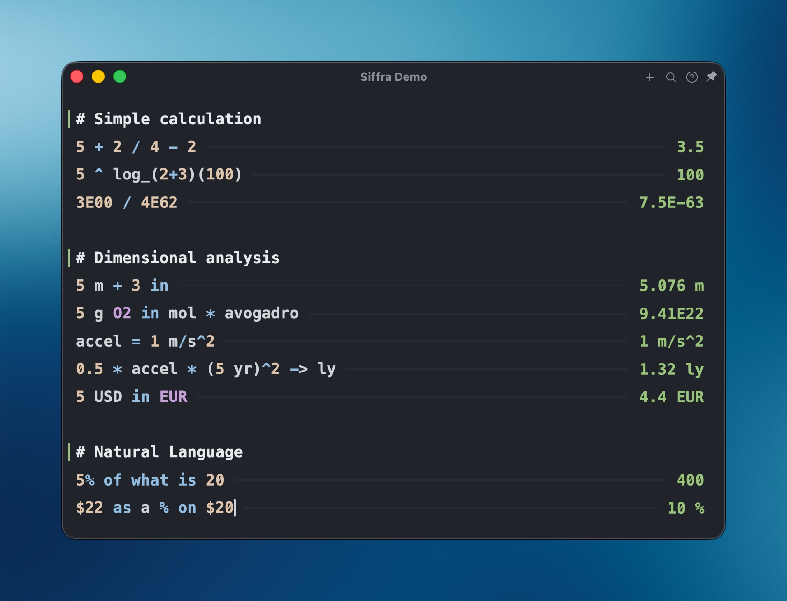

# Siffra

Siffra is a lightweight, fast, and accurate calculator with support for dimensional analysis built
with GPUI and Rust.

<div align="center">
    
</div>

## Installation

### Prebuild Binaries

There are provided prebuilt binaries for all platforms in the
[Releases tab](https://github.com/ImpossibleReality/Siffra/releases).

### Building from source

To build Siffra from source, you will need to have [Rust](https://www.rust-lang.org/tools/install)
installed.

You can then clone the repository and run Siffra with the following command:

```sh
cargo run
```

#### Linux

Linux has a few additional dependencies that need to be installed before building Siffra. You can
install them with the following command:

```sh
sudo apt-get install -y libxkbcommon-dev libxkbcommon-x11-dev libxcb-shape0-dev libxcb-xfixes0-dev libgtk-3-dev libwebkit2gtk-4.1-dev libssl-dev
```

#### Packaging

For a native installer, install `cargo-packager` and run
`cargo packager --release --packages siffra-desktop`.

Native release artifacts are built for macOS, Windows, and Linux. Please open an issue if you have
any problems running Siffra on your platform.

## Planned Features

- [x] Basic calculator functionality
- [x] Basic natural language support
- [x] Syntax highlighting
- [x] Variables support
- [x] Dimensional analysis
- [x] Unit conversion
    - [x] Basic units
    - [x] Dimensions w/ multiple units + exponents (ie. m/s^2)
    - [x] Derived units (ie. Jules, Newtons, etc.)
    - [x] Absolute units (ie. Temperature, time/date, etc.)
    - [x] Stoichiometry
    - [x] Full support for all SI units (including derived)
    - [x] Currency units
- [x] Error handling
- [x] Support for saving calculations
- [x] Updated with support for auto-updating
- [ ] Multi-window support
- [ ] Custom defined functions
- [ ] Preferences page
- [ ] Plugin + theme system

## Contributing

Any contributions to Siffra are welcome! If you would like to contribute, please see
[CONTRIBUTING.md](CONTRIBUTING.md) for guidelines.

## Supporting the project

If you find Siffra useful to you and would like to support my work, you can do so by buying me a
coffee using the button below. Thank you!

<a href="https://www.buymeacoffee.com/johannovak" target="_blank"></a>

## License

Siffra is licensed under the [MIT License](https://opensource.org/license/mit/)
